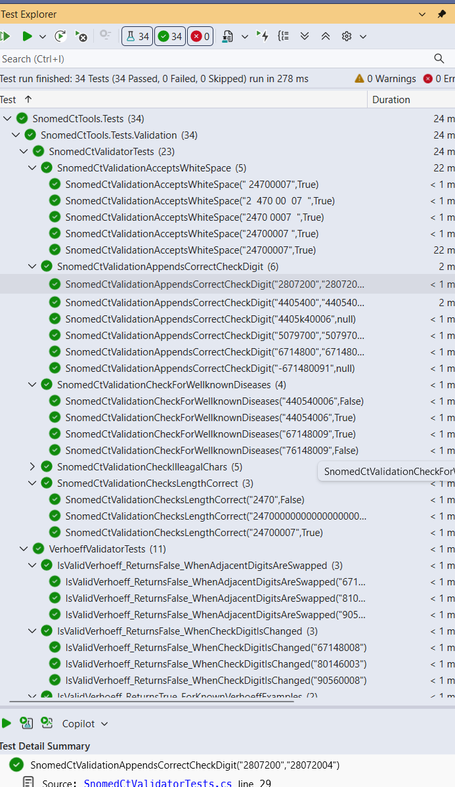

# SnomedCtTools lib 

**Snomed Ct** = Systemized Nomenclature Of MEDicine - Clinical terms .


## Validation of Snomed CT codes and generation of Verhoeff control digit

- Small .NET 10 library for validating SNOMED CT identifiers with the Verhoeff algorithm.
- Also includes method for generating a control digit using the 
  Verhoeff algorithm. This is to be appended to the input code


- Definition of a valid Snomed Ct code :

    - Consists only of positive digits 0-9
  (this lib accepts whitespace by the way) 
    - Code is of length 6 - 18 digits (whitespace removed)
    - Passes the Verhoeff algorithm by looking at the last digit, the control digit


<b>The Verhoeff algorithm is explained in these articles</b>

<a href='https://en.wikipedia.org/wiki/Verhoeff_algorithm'>https://en.wikipedia.org/wiki/Verhoeff_algorithm</a> <br />

 <a href='https://www.researchgate.net/publication/3084126_A_new_class_of_check-digit_methods_for_arbitrary_number_systems_Corresp'>
https://www.researchgate.net/publication/3084126_A_new_class_of_check-digit_methods_for_arbitrary_number_systems_Corresp</a>

Also check the following page for another implementation

https://en.wikibooks.org/wiki/Algorithm_Implementation/Checksums/Verhoeff_Algorithm#C#

My lib is the same, although it uses byte and char but overall is similar to the WikiBook C# code sample above. 

## Layout

- `Lib` contains the production library.
- `Tests` contains NUnit tests with FluentAssertions.

## Run the tests

```powershell
dotnet test SnomedCtTools.sln
```

In VS Code, use **Terminal: Run Task** and choose **Test solution**, or run the tests from the Testing view.

## Looking up Snomed CT codes online

There are multiple sites that offers browsing of Snomed Ct codes.

The CT Uk Browser is powerful in its presentation of not only Snomed Ct codes, but also their hierarchical relations to eachother and other relationships. 

https://termbrowser.nhs.uk/?

The Norwegian Snomed Ct browser offers a simplified search capability here : 
https://finnkode.helsedirektoratet.no/snomed/search

Each Snomed ct code opens up a more advanced search tool very similar to the Ct UK browser here : 

https://snowstorm.terminologi.helsedirektoratet.no/?perspective=full&conceptId1=188269007&edition=MAIN/SNOMEDCT-NO/2026-10-15&release=&languages=no,en


## The tests passes for wellknown Snomed CT codes




